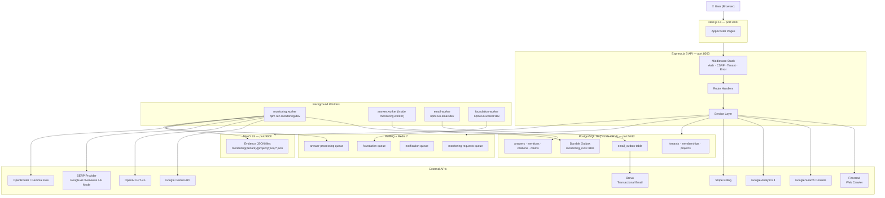
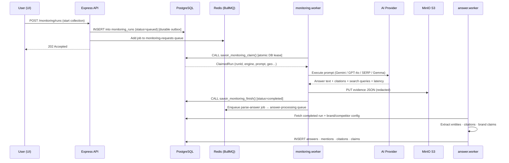
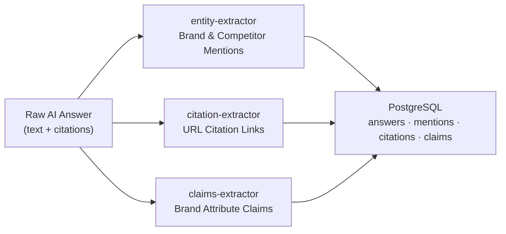
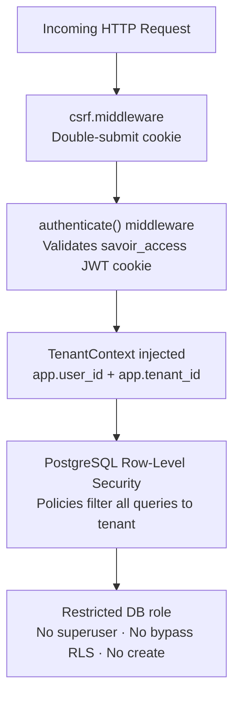
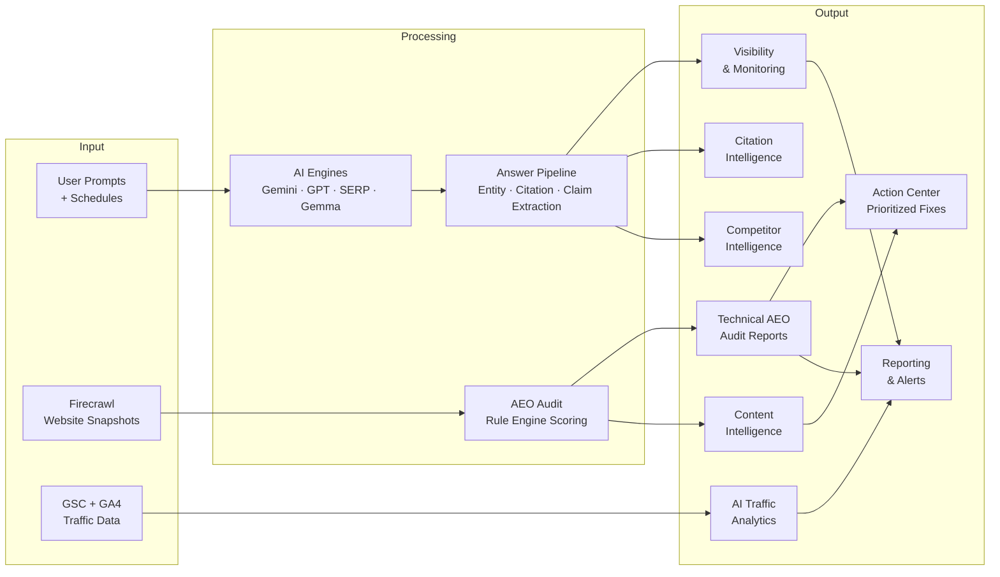

# How Savoir AEO/GEO Platform Works

> [!NOTE]
> Savoir is a multi-tenant SaaS platform that tracks **how AI answer engines** (Gemini, ChatGPT, Google AI Overviews, etc.) mention, cite, and rank your brand — and gives you tools to optimize that visibility.

---

## 1. The Big Picture

---

## 2. User Flow — From Signup to Insights

### Step 1 — Auth
- User signs up / logs in via `/auth` (cookie-based JWT: `savoir_access` + `savoir_refresh`).
- Google OAuth callback lands at `/auth/callback/google`.
- Every API request goes through **`authenticate()` middleware**, which reads the `savoir_access` cookie, validates the JWT, and resolves a `TenantContext { userId, tenantId }`.
- All database queries run in a **restricted PG role** with Row-Level Security — the middleware sets `app.user_id` and `app.tenant_id` session config vars so PG policies automatically filter to the right tenant.

### Step 2 — Onboarding / Project Setup
- User creates a **Project** (a website/brand they want to track).
- Adds tracking **Prompts** — the questions they want AI engines to answer (e.g., "What is the best CRM for startups?").
- Optionally adds **Competitors** and sets a monitoring schedule.

### Step 3 — Monitoring Collections (the core loop)

**Key design decisions:**
- **PostgreSQL = durable outbox.** The API writes the run to PG _before_ touching Redis. If Redis goes down, a periodic dispatcher re-reads PG and re-enqueues. Redis only holds run IDs — never prompts, API keys, or answer text.
- **DB leases via stored procedures** (`savoir_monitoring_claim`) prevent two workers from processing the same run.
- **Exponential backoff with jitter** — retries respect provider `Retry-After` headers; 429s are bounded to 4 attempts; auth failures and unknown quota rejections are _not_ retried automatically.
- **Evidence is redacted** before storage — emails and PII are stripped server-side.

---

## 3. Answer Processing Pipeline

After a run completes, `answer.worker` calls `processAnswerForRun()`:

This parsed data powers:
- **Answer Explorer** — browse raw AI answers per prompt
- **Visibility Analytics** — mention rate, position, sentiment trends
- **Citation Intelligence** — which URLs AI engines cite for your topics
- **Competitor Intelligence** — how competitors appear vs. your brand

---

## 4. AI Engine Support

| Engine | Adapter | Auth |
|:---|:---|:---|
| Google Gemini | `gemini.adapter.ts` | `GEMINI_API_KEY` (Google AI Studio) |
| OpenAI GPT-4o | `openai.adapter.ts` | `OPENAI_API_KEY` |
| Google AI Overviews / AI Mode | `serp.adapter.ts` | `SERP_PROVIDER_API_KEY` |
| OpenRouter / Gemma Free | `openrouter.adapter.ts` | `OPENROUTER_API_KEY` |

The **`MultiEngineProvider`** wraps all adapters — a single `execute(request)` call routes to the right provider based on `request.engine`. A **canary test** (asking "Name one landmark in Paris.") validates credentials without consuming monitoring credits.

---

## 5. Technical AEO Auditing

Powered by **Firecrawl** (`FIRECRAWL_API_KEY`):
- Crawls the user's website on demand.
- `technical-audit.service.ts` runs the **AEO Rule Engine** to score structured data, page speed, schema markup, robots.txt, `llms.txt`, and content structure.
- Results feed **Content Intelligence** (page-level optimization briefs) and the **Action Center** (prioritized fix list).

---

## 6. Remaining Modules

| Module | How it works |
|:---|:---|
| **AI Traffic Analytics** | Connects Google Search Console + GA4 via OAuth; `gsc-analyzer.ts` + `traffic-analytics.service.ts` classify AI referrers |
| **Reporting & Alerts** | `alert-engine.service.ts` evaluates thresholds; `report-generator.service.ts` assembles PDF/data exports |
| **Billing** | `stripe.adapter.ts` + `credit-ledger.service.ts` track monitoring credit consumption; Stripe webhooks handle plan changes |
| **Agent Experience (AXO)** | `axo.service.ts` + `robots-policy-builder.ts` draft and validate `robots.txt` / `llms.txt` AI crawl policies |
| **AI Search Grader** | `grader.service.ts` generates a shareable score card (`/grader/[shareToken]`) without requiring login |
| **Email** | Brevo transactional email via PG outbox pattern — the email worker polls every 5 s and sends up to 10 messages per tick |
| **Admin / Operator** | `operator.service.ts` provides a super-admin panel for user management, tenant oversight, and global config |

---

## 7. Security Model

- **No superuser DB role** in production — both the API and workers verify at startup that `rolsuper = false` and `rolbypassrls = false`.
- **Membership check** in every `withTenant()` call: confirms the user is an `owner` of the requested tenant before executing any query.
- **CSRF protection** on all state-changing routes.
- **Provider API keys** live only in `server/.env` — never sent to the browser or stored in Redis.

---

## 8. Data Flow Summary

