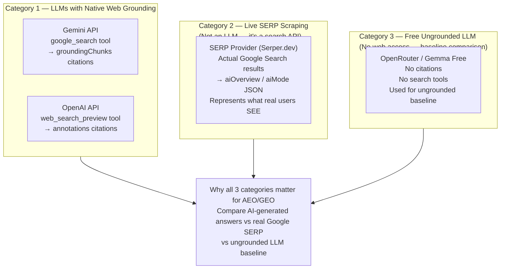
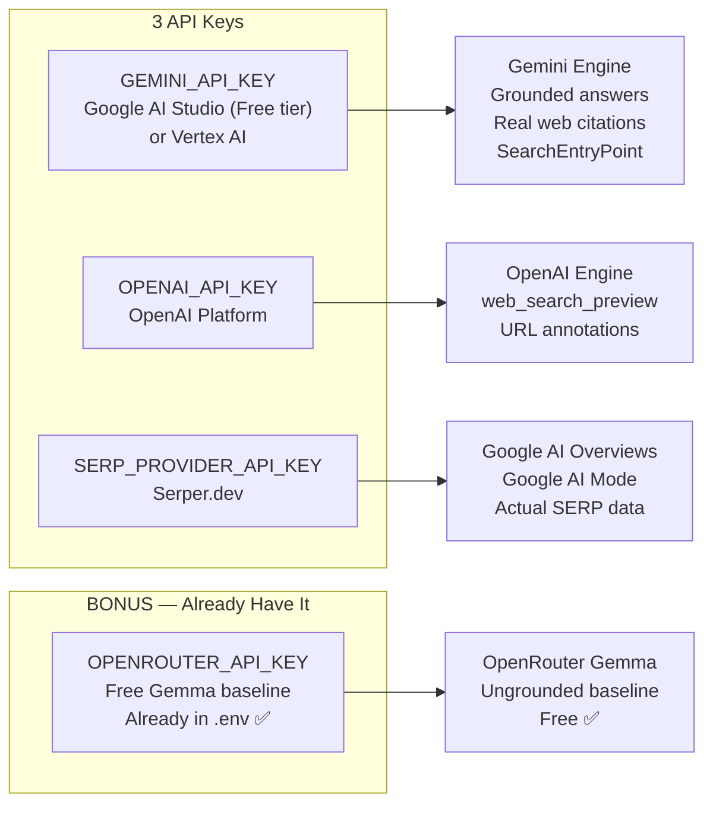

# AI Engine Unified Provider — Deep Analysis

> [!IMPORTANT]
> **Short Answer:** No single API key can replace ALL four engine types in Savoir. Here's exactly why — and the best strategy for your project.

> [!NOTE]
> **Research-validated:** Deep analysis of OpenRouter, LiteLLM, Portkey.ai, Requesty.ai, Vertex AI, and Azure AI Foundry confirms the current 4-provider architecture is already the optimal design. No gateway can consolidate all categories without meaningful loss.

---

## What Your Code Actually Needs (From Source Analysis)

Your four adapters each need **fundamentally different things**:

| Engine | Adapter File | What It Calls | Critical Feature Needed |
|:---|:---|:---|:---|
| **Gemini** | `gemini.adapter.ts` | `generativelanguage.googleapis.com` | `google_search` tool → `groundingMetadata` + `groundingChunks` (real web citations) |
| **OpenAI GPT-4o** | `openai.adapter.ts` | `api.openai.com/v1/chat/completions` | `web_search_preview` tool → structured `annotations` (URL citations) |
| **Google AI Overviews / AI Mode** | `serp.adapter.ts` | `google.serper.dev/search` | Actual **live Google SERP results** — `aiOverview`, `aiMode` JSON — not an LLM at all |
| **OpenRouter / Gemma** | `openrouter.adapter.ts` | `openrouter.ai/api/v1/chat/completions` | Free models only (`:free` suffix enforced), **no web search** (intentional — ungrounded answers) |

---

## The Fundamental Split: 3 Distinct Categories



> [!WARNING]
> **Google AI Overviews** (Category 2) is NOT an LLM call. It's the actual Google Search page result. No LLM gateway can replicate this — you need a real SERP provider that scrapes/licenses actual Google results.

---

## Can a Unified Gateway Replace Everything?

### OpenRouter (Already in Your Stack)

| Feature | Available? | Notes |
|:---|:---|:---|
| Gemini models | ✅ Yes | `google/gemini-2.5-flash`, `google/gemini-2.5-pro` |
| GPT-4o | ✅ Yes | `openai/gpt-4o` |
| Gemma Free | ✅ Yes | `google/gemma-4-31b-it:free` (already configured) |
| Claude | ✅ Yes | `anthropic/claude-sonnet-4-5` etc. |
| **Gemini with Google Search Grounding** | ❌ **NO** | OpenRouter does NOT pass through the `google_search` tool or return `groundingMetadata`. Citations are stripped. |
| **OpenAI `web_search_preview`** | ❌ **NO** | Tool not supported through OpenRouter proxy |
| **Google AI Overviews** | ❌ **NO** | Not an LLM — SERP scraping only |
| OpenAI-compatible API | ✅ Yes | Drop-in `/v1/chat/completions` |
| Single API key | ✅ Yes | One `OPENROUTER_API_KEY` for all LLMs |

**Verdict on OpenRouter:** Great for routing between ungrounded LLMs with one key. **Cannot replace Gemini grounding or SERP data.**

---

### Other AI Gateways (LiteLLM, Portkey, Requesty, etc.)

| Gateway | Gemini Grounding | OpenAI Web Search | Google AI Overviews | Single Key |
|:---|:---|:---|:---|:---|
| **LiteLLM** | ❌ Strips tools | ❌ Strips tools | ❌ Not SERP | ✅ |
| **Portkey.ai** | ❌ No grounding passthrough | ❌ | ❌ | ✅ |
| **Requesty.ai** | ❌ | ❌ | ❌ | ✅ |
| **Azure AI** | ❌ No Gemini | ✅ Via Azure OpenAI | ❌ | ✅ (Azure only) |
| **Vertex AI** | ✅ Yes! | ❌ No GPT-4o | ❌ | ✅ (Google only) |

> [!NOTE]
> **Why grounding fails through gateways:** Your `gemini.adapter.ts` sends `tools: [{ google_search: {} }]` and parses `groundingMetadata.groundingChunks` for real citations. Proxy gateways either strip tool definitions or don't relay the structured grounding metadata back — the core value of Gemini monitoring is lost.

---

## The Best Strategy for Your Project

### Recommended Setup: 4 Keys, Maximum Value (Already Your Architecture)



### Why This Is Already Your Current Setup — And It's Correct

Looking at your `.env`, you already have:
```env
SERP_PROVIDER_API_KEY=f159627...   ✅ (Serper.dev) — Live Google SERP data
OPENROUTER_API_KEY=sk-or-v1-...   ✅ (Gemma free) — Free ungrounded baseline
OPENAI_API_KEY=your_openai_...    ⚠️  Placeholder — not set → needs real key
GEMINI_API_KEY=                   ⚠️  Not set → most critical gap
```

> [!TIP]
> Your `env.ts` even **hard-rejects** OpenRouter keys for Gemini (`GEMINI_API_KEY` validator explicitly rejects `sk-or-` prefix with message "Use OPENROUTER_API_KEY for OpenRouter credentials"). The two-track design is enforced at the config level on purpose.

---

## Provider-by-Provider Recommendation

### 1. Gemini — Use Google AI Studio Direct Key ⭐ BEST FOR AEO

**Why native Gemini API is irreplaceable:**
- Your `gemini.adapter.ts` uses `tools: [{ google_search: {} }]` — this is a **Google-proprietary grounding tool**
- Returns `groundingMetadata.groundingChunks[]` with real web sources — this is what powers your **Citation Intelligence** module
- Returns `searchEntryPoint` — the actual AI Overview entry point data
- No gateway passes this through intact

**Get your key:** [aistudio.google.com](https://aistudio.google.com) → Create API key
- **Free tier:** 15 req/min, 1500 req/day for `gemini-2.5-flash`
- **Paid:** \$0.075/M input tokens, \$0.30/M output tokens (flash)
- Grounding costs extra: ~\$35/1000 grounded queries (paid tier)

```env
GEMINI_API_KEY=AIza...your_key_here
GEMINI_MODEL=gemini-2.5-flash
```

---

### 2. OpenAI GPT-4o — Direct OpenAI Key ⭐ REQUIRED FOR WEB SEARCH

**Why native OpenAI API is irreplaceable:**
- Your `openai.adapter.ts` sends `tools: [{ type: "web_search_preview" }]`
- Returns structured `message.annotations[]` with URL citations
- `web_search_preview` is an **OpenAI-proprietary tool** — not available through any proxy

**Get your key:** [platform.openai.com](https://platform.openai.com) → API Keys
- GPT-4o: \$2.50/M input, \$10/M output + \$30/1000 web searches
- GPT-4o-mini: \$0.15/M input, \$0.60/M output (cheaper option)

```env
OPENAI_API_KEY=sk-...your_key_here
OPENAI_MODEL=gpt-4o
```

---

### 3. Google AI Overviews / AI Mode — Serper.dev ⭐ ALREADY CONFIGURED

**Why SERP is irreplaceable:**
- This is NOT an LLM. `serp.adapter.ts` calls `serper.dev/search` with `type: "search"` or `type: "ai_mode"`
- Returns actual `aiOverview` / `aiMode` JSON — what real Google users see on their SERP
- This is the most AEO-critical data: **Are you appearing in real Google AI Overviews?**
- No LLM gateway can simulate this

**Your key is already set:** `SERP_PROVIDER_API_KEY=f159627...` ✅

**Pricing:** Serper.dev — 2,500 free queries/month, then \$50/50k queries

---

### 4. OpenRouter / Gemma — Already Set Up ✅

**What it provides:**
- Free baseline using `google/gemma-4-31b-it:free`
- **Intentionally ungrounded** — your `openrouter.adapter.ts` explicitly says "no web search" in the system prompt
- Used as a cost-free baseline to compare against grounded answers
- Already fully configured in your `.env`

```env
OPENROUTER_API_KEY=sk-or-v1-...  ✅ Already set
OPENROUTER_MODEL=google/gemma-4-31b-it:free  ✅ Already set
```

---

## Could OpenRouter Replace Gemini + OpenAI for Basic Use?

**Yes, partially — if you sacrifice citation quality:**

```env
# OpenRouter-only setup (budget mode, loses grounding)
OPENROUTER_API_KEY=sk-or-v1-...
OPENROUTER_MODEL=google/gemma-4-31b-it:free

# You could also route paid models via OpenRouter:
# google/gemini-2.5-flash → no grounding
# openai/gpt-4o → no web_search_preview
```

> [!CAUTION]
> Using OpenRouter for Gemini loses **all citation data** — `groundingChunks` returns empty. This breaks Citation Intelligence, since your `citation-extractor.ts` depends on real grounding sources. The core value proposition of Savoir is undermined.

---

## Final Decision Matrix

| Scenario | Keys Needed | Citation Quality | Cost/Month (est.) | Recommended? |
|:---|:---|:---|:---|:---|
| **Full production** | 4 (Gemini + OpenAI + Serper + OpenRouter) | ⭐⭐⭐⭐⭐ Full grounding | \$50–200+ | ✅ **Best** |
| **Budget — Gemini + Serper only** | 2 | ⭐⭐⭐⭐ Gemini grounded | \$20–80 | ✅ Good start |
| **Requesty BYOK** | 1 (Requesty) + own provider keys | ⭐⭐⭐⭐ (but no AI Overviews) | +5% or 0% markup | ⚠️ Adds latency/dependency |
| **OpenRouter paid models only** | 1 (OpenRouter) | ⭐⭐ No native grounding | \$10–50 | ❌ Loses citations |
| **OpenRouter free only** | 1 (OpenRouter `:free`) | ⭐ No citations | \$0 | ❌ Loses core value |

---

## SERP Provider Comparison (for `SERP_PROVIDER_API_KEY`)

Your `serp.adapter.ts` reads from `SERP_PROVIDER_BASE_URL` (defaults to `https://google.serper.dev`). This is **fully swappable** — here are your options:

| Provider | AI Overview Support | Pricing | Reliability | Notes |
|:---|:---|:---|:---|:---|
| **Serper.dev** ✅ Current | ✅ `aiOverview` field | 2,500 free/mo → \$50/50k | Fast, cheap | May miss async-rendered AIOs |
| **SerpApi** | ✅ Dedicated `google_ai_overview` engine | \$50/5k → \$150/15k | Most robust | 2-step `page_token` for async AIO rendering |
| **DataForSEO** | ✅ | Volume-based | High-volume friendly | Best for >100k queries/mo |
| **ValueSERP / SerpWow** | ⚠️ Partial | \$30/50k | Lightweight | Less reliable AIO capture |
| **Bright Data** | ✅ | Premium | Enterprise-grade | Overkill for most use cases |

> [!TIP]
> If your AI Overview **capture rate** feels low in production (many queries returning "No Google AI Overview was triggered"), switch from Serper.dev to **SerpApi** — it uses a two-step token approach that handles Google's JavaScript-async AIO rendering more reliably.

---

## Immediate Action: Set Your Missing Keys

Add to `server/.env`:

```env
# 1. Get from: https://aistudio.google.com
GEMINI_API_KEY=AIza...

# 2. Get from: https://platform.openai.com/api-keys  
OPENAI_API_KEY=sk-...

# 3. Already set ✅
SERP_PROVIDER_API_KEY=f159627eee96917a227820004bc75ac792eef03e

# 4. Already set ✅
OPENROUTER_API_KEY=sk-or-v1-3764013f...
OPENROUTER_MODEL=google/gemma-4-31b-it:free
```

After updating, restart both the API and monitoring worker:
```bash
# Terminal 1
cd server && npm run dev

# Terminal 2
cd server && npm run monitoring:dev
```

Verify credentials without consuming monitoring credits:
```bash
cd server
npm run monitoring:check                        # Checks Gemini
npm run monitoring:check -- --engine=openai     # Checks OpenAI
npm run monitoring:check -- --engine=openrouter # Checks OpenRouter (already works)
```
